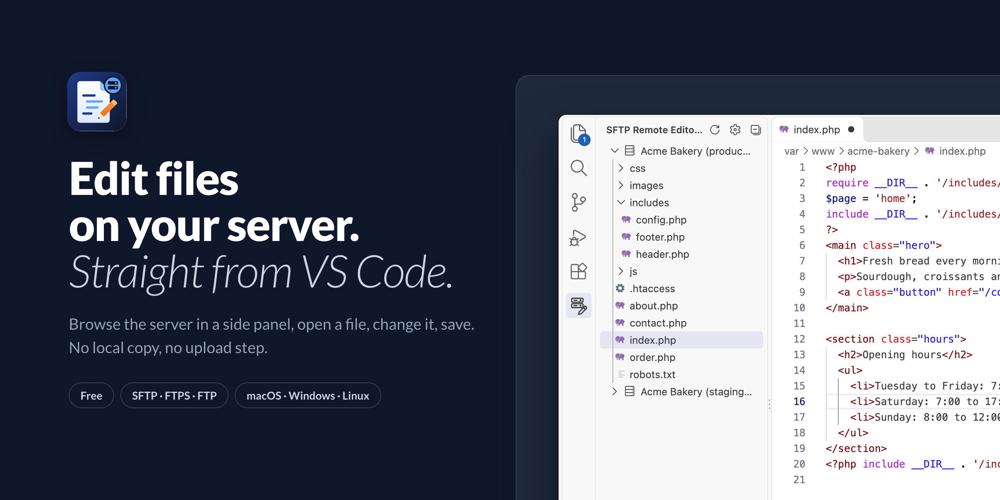
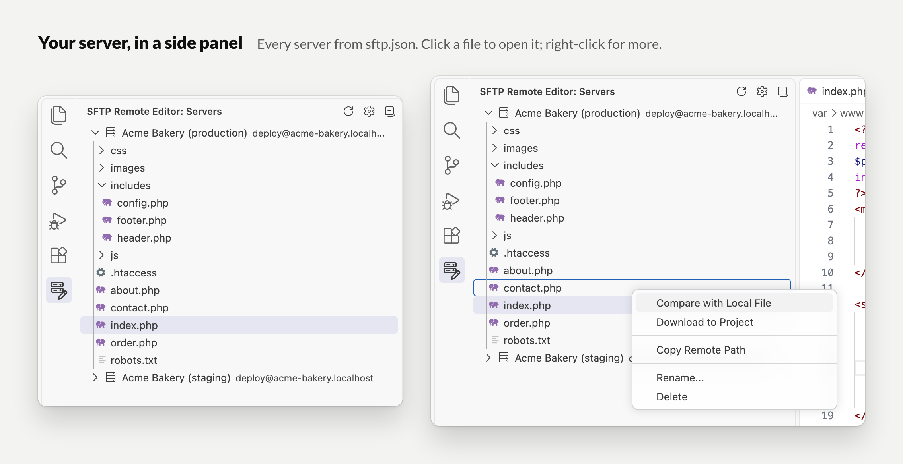
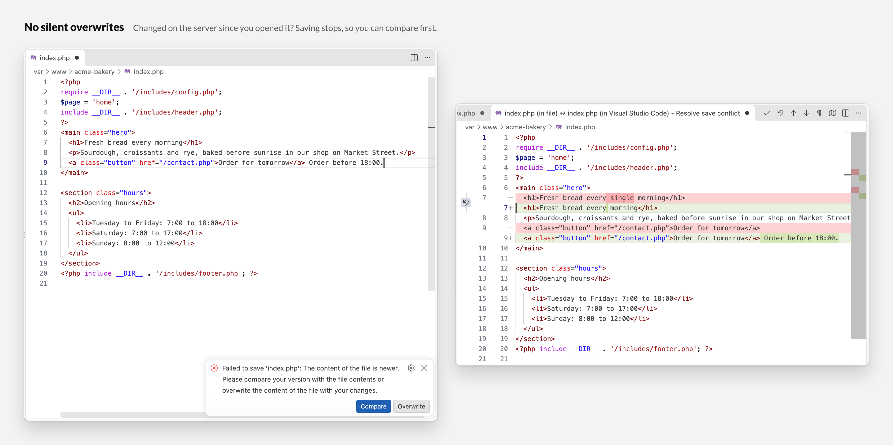
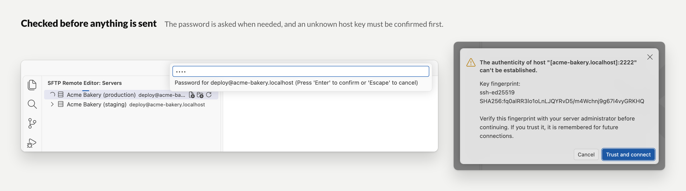
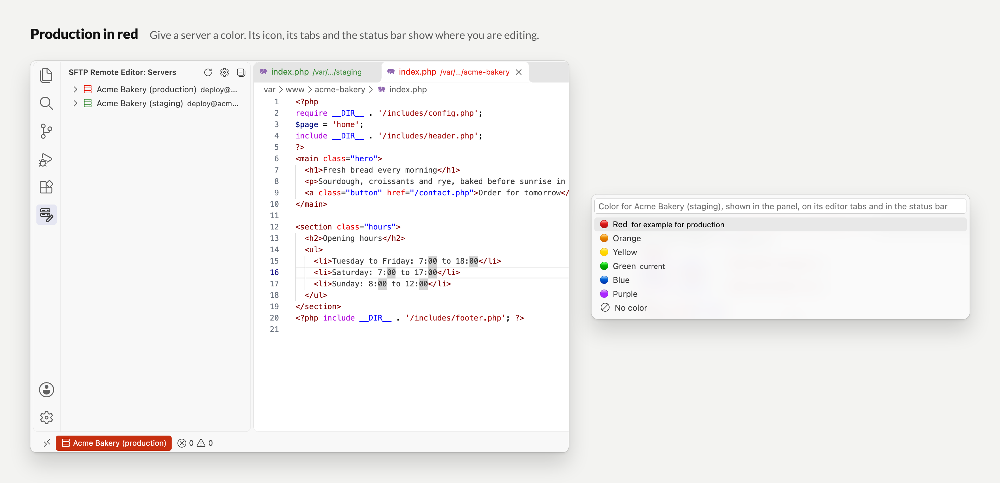
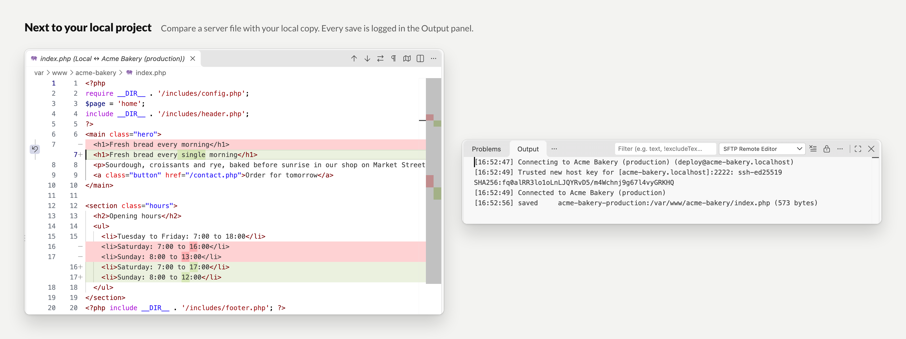

# SFTP Remote Editor

[](https://marketplace.visualstudio.com/items?itemName=delta-solutions.sftp-remote-editor)
[](https://marketplace.visualstudio.com/items?itemName=delta-solutions.sftp-remote-editor)
[](https://marketplace.visualstudio.com/items?itemName=delta-solutions.sftp-remote-editor&ssr=false#review-details)
[](https://open-vsx.org/extension/delta-solutions/sftp-remote-editor)
[](LICENSE)



**Edit files on your server, in place.** Browse the server in a side panel, click a file, change it and press Save: it is written straight to the server. No local copy, no upload step, nothing to sync.

It reads the `.vscode/sftp.json` you already have, so there is nothing to set up.

**[Install from the VS Code Marketplace](https://marketplace.visualstudio.com/items?itemName=delta-solutions.sftp-remote-editor)** · **[Open VSX for Cursor, VSCodium and Windsurf](https://open-vsx.org/extension/delta-solutions/sftp-remote-editor)** · Free, MIT licensed, macOS, Windows and Linux.

## Why

A typo on a live page, a setting in a config file, a quick look at what is really on the server. In other editors you open the remote host, double-click the file and save. In VS Code that meant downloading the file into your project first, or connecting the whole window to the server.

SFTP Remote Editor gives you the remote host view:

- **The server in a side panel.** Every server in your `sftp.json`, with its folders and files. Folders load when you open them.
- **Edit in place.** A file opens in a normal editor, with syntax highlighting, search and everything else. Save writes it to the server.
- **No silent overwrites.** If someone changed the file on the server after you opened it, saving stops and you compare first.
- **Permissions stay as they are.** A saved file keeps its owner and permissions. New files get the server's defaults.
- **Production in red.** Give a server a color, and its icon, its editor tabs and the status bar show it. You always see which server you are editing.
- **Your existing config.** Same `.vscode/sftp.json` as Git SFTP Upload, SFTP Folder Upload and the SFTP extension by Natizyskunk, including profiles and multiple servers.
- **SFTP, FTPS and FTP.** Password, private key or SSH agent for SFTP. Explicit or implicit TLS for FTPS.

### Made for the quick fix on the server

A setting in `wp-config.php` or `.env`, a `.htaccess` rule, a log file you want to read, a hotfix that cannot wait for the next deploy. A WordPress site on shared hosting, a PHP or Laravel app on a VPS, a client's staging server: SFTP Remote Editor opens the file from the server, next to your local project, and saves it back when you press Save.

| | FTP client | SFTP extension, *Edit in Local* | Remote - SSH | **SFTP Remote Editor** |
|---|:---:|:---:|:---:|:---:|
| Edit the file on the server itself | Temporary copy, uploaded again | Downloaded into your project | Yes | **Yes, no local copy** |
| Stays next to your local project | Separate app | Yes | No, the whole window moves | **Yes, a side panel** |
| Nothing to install on the server | Yes | Yes | Needs shell access and a VS Code server | **Yes, plain SFTP or FTPS** |
| Production clearly marked | Varies | No | Host name in the status bar | **Yes, in red** |
| Uses your existing `sftp.json` | No | Yes | No | **Yes** |

## Get started in 30 seconds

1. **Install** the extension. A server icon with a pencil appears in the Activity Bar.
2. **Point it at your server** with a `.vscode/sftp.json` (see [Configuration](#configuration)), or click **Create sftp.json** in the panel. Already using Git SFTP Upload, SFTP Folder Upload or the SFTP extension by Natizyskunk? Then you have one, skip this step.
3. **Expand a server**, click a file, edit, save. Done. Right-click your production server › **Set Color...** › red while you are there.

## A quick tour

### Your server, in a side panel

Click the **server icon with the pencil** in the Activity Bar. Every server from your `sftp.json` is listed; expand one to connect and browse. Click a file to open it. Right-click for **Compare with Local File**, **Download to Project**, **Copy Remote Path**, **Rename** and **Delete**. The icons next to a folder create a new file or folder in it.



### No silent overwrites

VS Code checks the file on the server before it saves. When a colleague changed it in the meantime, the save is refused with *The content of the file is newer*. **Compare** shows both versions side by side, **Overwrite** saves yours anyway.



### Checked before anything is sent

With `"password": true` the password is asked when you connect and kept in memory for the session only. The first time you connect to a server, its SSH host key fingerprint is shown and must be confirmed before the password is sent. A key that later changes is refused.



### Production in red

Right-click a server › **Set Color...** and pick red, orange, yellow, green, blue or purple. The server icon in the panel, the tabs of its open files and the file names in the panel get that color, and the status bar names the server of the file you are editing, on a red background for red and a yellow one for orange and yellow. The color is stored as `"color": "red"` in `sftp.json`, per server or per profile, so the whole team sees production in red.

```jsonc
"profiles": {
  "production": { "host": "acme-bakery.be", "color": "red" },
  "staging": { "host": "staging.acme-bakery.be", "color": "green" }
}
```



### Next to your local project

**Compare with Local File** opens a diff between the file on the server and the same file in your project. Every connection and every save is logged in the Output panel under *SFTP Remote Editor*.



## Configuration

A minimal `.vscode/sftp.json`:

```json
{
  "name": "My site (production)",
  "host": "example.com",
  "protocol": "sftp",
  "username": "deploy",
  "password": true,
  "remotePath": "/var/www/mysite"
}
```

Supported: `name`, `host`, `port`, `username`, `password`, `privateKeyPath`, `passphrase`, `agent`, `remotePath`, `context`, `connectTimeout`, `color`, `profiles`, and an array of configs. Each profile is shown as a separate server. `context` is the local folder that corresponds to `remotePath`, used by **Compare with Local File** and **Download to Project**.

Protocols:

- `"protocol": "sftp"` (default): SFTP over SSH, with password, private key or agent authentication.
- `"protocol": "ftp"`: FTPS with explicit TLS on port 21 by default. `"secure": "implicit"` uses implicit FTPS on port 990. `"secureOptions"` is passed to Node's TLS connection. Unencrypted FTP is only used with an explicit `"secure": false`.

Settings:

| Setting | Default | |
| --- | --- | --- |
| `sftpRemoteEditor.configFile` | `.vscode/sftp.json` | Path to the config, inside the workspace folder. |
| `sftpRemoteEditor.idleDisconnectMinutes` | `10` | Close a connection after this many idle minutes. It reconnects when needed. `0` keeps it open. |

## Security

- **Host key verification (SFTP).** The server's SSH host key is checked against `~/.ssh/known_hosts`. Unknown hosts are shown once with their fingerprint and must be confirmed before the password is sent; the key is then remembered. A key that no longer matches is refused. Use **SFTP Remote: Forget Trusted Host Keys** if a server key was changed on purpose.
- **Encrypted by default (FTP).** `"protocol": "ftp"` means FTPS with certificate verification. Plain FTP requires `"secure": false` and is flagged in the Output panel.
- **No passwords on disk.** With `"password": true` the password is asked when needed and kept in memory for the session only. A plaintext password in `sftp.json` is flagged in the Output panel.
- **Permissions are kept.** Saving over SFTP overwrites the file in place without changing its mode, so a file never becomes world-writable by being edited.
- **Trusted workspaces only.** The extension stays disabled in Restricted Mode, because the workspace itself decides which servers it connects to.

Found a security issue? Please report it privately, see [SECURITY.md](SECURITY.md).

## FAQ

**Is a saved file really live right away?**
Yes. Save writes the file on the server, outside git. Use it to inspect files or for an urgent fix, and put that fix in your repository afterwards.

**How is this different from the Remote Explorer of the SFTP extension?**
Its *Edit in Local* downloads the file into your project and uploads it again when you save. SFTP Remote Editor opens the file from the server itself; nothing is written to your project unless you choose **Download to Project**.

**Why not Remote - SSH?**
Remote - SSH connects the whole window to the server and installs a VS Code server there, which needs shell access. SFTP Remote Editor works next to your local project, over plain SFTP or FTPS, without installing anything on the server.

**Does it work together with Git SFTP Upload and SFTP Folder Upload?**
Yes. All three read the same `sftp.json`. Use Git SFTP Upload to deploy what you changed in git, SFTP Folder Upload to send a whole folder, and SFTP Remote Editor to look at or fix a file on the server.

**Does it replace the SFTP extension by Natizyskunk?**
No, it complements it. That extension syncs, downloads and uploads on save. SFTP Remote Editor edits a file on the server without a local copy. Both read the same `sftp.json` and can be installed together.

**Can I work on staging and production?**
Yes. Use `profiles` or an array of configs in `sftp.json`. Each one is a separate server in the panel, and a color per profile keeps production in red and staging in green.

**Can I see which server a file belongs to?**
Yes. Give the server a color and its editor tabs get that color. The status bar always names the server of the file you are editing.

**Does it notice files that others add on the server?**
The server is not watched. Use **Refresh** in the panel to reload a folder.

**Does it work with Cursor, VSCodium or Windsurf?**
Yes, install it from [Open VSX](https://open-vsx.org/extension/delta-solutions/sftp-remote-editor).

## Works well with

All three read the same `.vscode/sftp.json`.

- **[Git SFTP Upload](https://marketplace.visualstudio.com/items?itemName=delta-solutions.git-sftp-upload):** upload only the files you changed in git, in one click from Source Control.
- **[SFTP Folder Upload](https://marketplace.visualstudio.com/items?itemName=delta-solutions.sftp-folder-upload):** upload a folder or your whole project in one go, symlinks included.

## Like it?

- **Rate it** on the [Marketplace](https://marketplace.visualstudio.com/items?itemName=delta-solutions.sftp-remote-editor&ssr=false#review-details). A short review helps other developers find it.
- **Star it** on [GitHub](https://github.com/dietercoopman/sftp-remote-editor).
- **Ideas or bugs?** [Open an issue](https://github.com/dietercoopman/sftp-remote-editor/issues/new/choose).

## Publisher

Made by [Delta Solutions](https://www.deltasolutions.be/) in Belgium. More free tools in the [Delta Tools Center](https://www.deltasolutions.be/delta-tools-center/).
